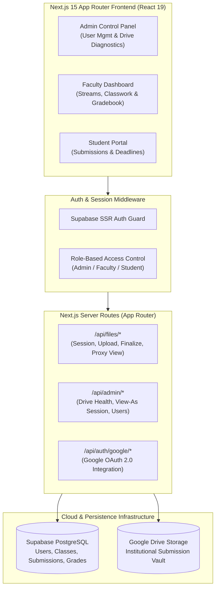
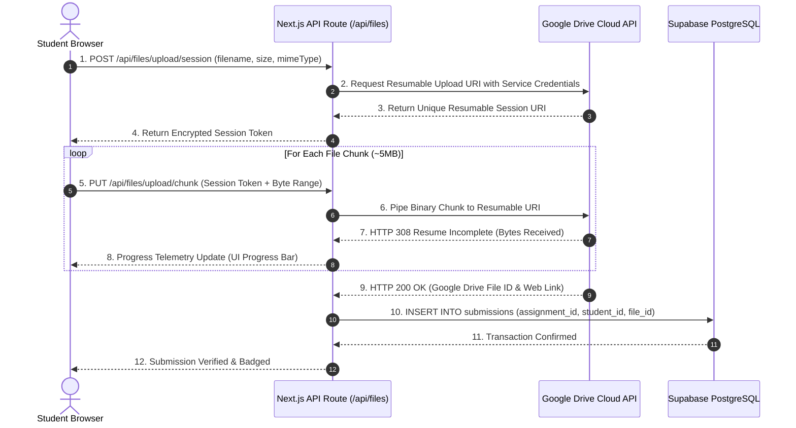

# Faculty Classroom Dashboard

<p align="center">
  <strong>Institutional Academic Platform & Google Drive Submission Engine</strong><br>
  <em>Multi-role course management, chunked Google Drive cloud storage, dynamic rubric grading, and real-time student evaluation analytics built with Next.js 15 & Supabase.</em>
</p>

<p align="center">
  
  
  
  
  
  
</p>

---

## Overview

**Faculty Classroom Dashboard** (hosted in repository `google-classroom-clone`) is an institutional-grade, multi-role academic classroom operating platform inspired by Google Classroom. Engineered with **Next.js 15 (App Router)**, **React 19**, **Supabase SSR**, and the **Google Drive API**, this system delivers full-lifecycle assignment distribution, chunked multi-file student submissions, rubric-based evaluation, grade analytics, and administrative audit controls.

Designed for modern universities and colleges, the platform bridges the gap between institutional course management and reliable cloud storage. By delegating file payloads to a dedicated Google Drive institutional vault through chunked resumable upload sessions, the system eliminates traditional web server file size limits while maintaining strict PostgreSQL Row-Level Security (RLS) over coursework, submissions, and grades.

---

## The Academic Submission Bottleneck & The Faculty Dashboard Solution

### The Challenge
- **Storage Quota & Server Upload Limits:** Traditional LMS platforms crash or reject large student assignments (engineering CAD models, zip archives, high-res design PDFs) due to restrictive web server multipart upload caps.
- **Credential Exposure & Direct S3 Costs:** Routing file uploads directly to raw AWS S3 buckets exposes cloud API keys to client browsers and generates high egress bandwidth costs for university departments.
- **Lack of Multi-Role Impersonation for Audits:** Academic coordinators and department heads cannot easily audit student claims ("my submission didn't upload") without compromising student passwords.
- **Fragmented Document Previewing:** Faculty members are forced to download hundreds of individual DOCX and PDF assignments locally to grade them, creating security vulnerabilities and wasted disk space.

### The Faculty Dashboard Solution
- **Chunked Resumable Google Drive Pipeline:** Heavy file uploads are brokered through an authorized backend proxy that initiates resumable Google Drive sessions, streaming chunks with automated retries.
- **Supabase SSR & Row-Level Security:** Database policies enforce absolute role isolation between Professors, Teaching Assistants, Students, and Institutional Administrators.
- **Secure "View-As" Administrative Impersonation:** Department heads can inspect student or faculty workspaces securely via `/api/admin/view-as` sessions without needing student credentials.
- **In-Browser Academic Document Parsing:** Integrated **Mammoth.js** renders DOCX papers directly in the grading interface with zero client downloads required.

---

## Architecture & Data Flow

### System Topology



---

### Resilient Chunked Google Drive Upload Sequence



---

## Core Implemented Capabilities

### 1. Multi-Tier Role-Based Security & View-As Impersonation
- **Faculty Dashboard (`/dashboard`):** Manage course cohorts, syllabi, and multi-threaded class announcement streams with rich assignment authoring.
- **Student Workspace (`/student`):** Unified course feed with upcoming assignment deadline alerts, submission status badges (`Submitted`, `Late`, `Missing`, `Graded`), and gradebook inspection.
- **Admin Control Center (`/admin`):** Institutional user provisioning, Google Drive health diagnostics (`/api/admin/drive-health`), and secure **"View-As" Impersonation** (`/api/admin/view-as`) for faculty audits without credential handoffs.

### 2. Resilient Chunked Google Drive Cloud Vault
- **Chunked Resumable Uploads:** Handles large academic documents reliably through `/api/files/upload/session` and `/api/files/upload/finalize`.
- **Authorized File Proxy:** Submissions are previewed securely through an authorized server proxy (`/api/files/view/[fileId]`), preventing direct bucket exposure.
- **Migration & Verification Tools:** Bundled scripts for file transfer, backfilling, and integrity validation (`npm run migrate:files`, `npm run verify:drive-files`).

### 3. In-Browser Document Parsing & Grade Analytics
- **DOCX In-Browser Renderer:** Integrated **Mammoth.js** parses and renders Word documents directly in the faculty evaluation drawer.
- **Grade Distribution Analytics:** Interactive class performance histograms and submission velocity powered by **Chart.js** and **react-chartjs-2**.
- **Automated Gradebook PDF Export:** Generates clean, printable institutional grade sheets via **jsPDF** and **jspdf-autotable**.

---

## Technology Stack

Verified directly from source code and package configurations:

| Component | Technology | Description |
|---|---|---|
| **Framework** | Next.js 15.5.22 | App Router, Server Actions, Server Components, Turbopack |
| **Frontend Core** | React 19.0.0, TypeScript 5.7 | Modern typed UI foundation with concurrent rendering |
| **Styling & UI** | Tailwind CSS 3.4, Framer Motion 11.15 | Fluid animations, responsive course cards, and modal sheets |
| **Database & Auth** | Supabase SSR (`@supabase/ssr`, `@supabase/supabase-js`) | PostgreSQL relational database with Row-Level Security policies |
| **Cloud Storage** | Google APIs (`googleapis` 174.0) | Resumable Drive file sessioning and institutional file vault |
| **Document Processing** | Mammoth 1.12 | In-browser client-side rendering of academic `.docx` submissions |
| **Data Visualization** | Chart.js 4.4 & react-chartjs-2 | Visual grade distribution charts and assignment submission timelines |
| **Export Engine** | jsPDF 4.2 & jspdf-autotable 5.0 | Printable departmental grade registers and accreditation reports |

---

## Repository & Directory Structure

```text
google-classroom-clone/
├── app/
│   ├── admin/                    # Admin portal: user management & drive diagnostics
│   ├── api/
│   │   ├── admin/                # Admin APIs: drive-health, users, view-as sessions
│   │   ├── auth/google/          # OAuth 2.0 Google callback endpoints
│   │   └── files/                # File sessioning, upload finalize, deletion & proxy view
│   ├── dashboard/                # Faculty course streams, assignment creation, gradebook
│   ├── student/                  # Student portal: enrollments, submissions & deadlines
│   ├── layout.tsx                # Root layout with Supabase session provider
│   └── page.tsx                  # Landing page & unified login portal
├── components/                   # Reusable UI components
│   ├── AssignmentCard.tsx        # Assignment item with deadline and submission badge
│   ├── ClassStream.tsx           # Interactive announcement and discussion stream
│   ├── DocumentViewer.tsx        # Mammoth.js DOCX and PDF preview modal
│   └── GradebookTable.tsx        # Faculty grading matrix with live score inputs
├── lib/
│   ├── google-drive.ts           # Google Drive API client & resumable session helpers
│   └── supabase/                 # Supabase client, server, and middleware helpers
├── scripts/
│   ├── migrate_files.js          # File transfer and Drive backfilling utility
│   └── verify_drive_files.js     # Health check and orphaned file detector
├── package.json                  # Dependencies and build scripts
└── tsconfig.json                 # TypeScript compiler configuration
```

---

## Getting Started & Local Development

### Prerequisites
- **Node.js**: `v20.0.0` or higher
- **npm** or **pnpm**
- **Supabase Account**: Hosted project or local Supabase CLI instance
- **Google Cloud Console**: OAuth 2.0 Client ID and Service Account with Drive API enabled

### 1. Clone the Repository
```bash
git clone https://github.com/Swaraj0160/google-classroom-clone.git
cd google-classroom-clone
```

### 2. Configure Environment Variables
Create a `.env.local` file in the root directory:
```env
# Supabase Configuration
NEXT_PUBLIC_SUPABASE_URL=https://your-project.supabase.co
NEXT_PUBLIC_SUPABASE_ANON_KEY=your-anon-key
SUPABASE_SERVICE_ROLE_KEY=your-service-role-key

# Google Drive Integration
GOOGLE_CLIENT_ID=your-google-oauth-client-id
GOOGLE_CLIENT_SECRET=your-google-oauth-client-secret
GOOGLE_DRIVE_FOLDER_ID=your-institutional-folder-id
```

### 3. Install Dependencies
```bash
npm install
```

### 4. Run Development Server
```bash
npm run dev
```
Navigate to `http://localhost:3000` to access the portal.

---

## Verification & Integrity Scripts

The repository includes administrative maintenance scripts for cloud file integrity:

```bash
# Verify all Google Drive submission file mappings against Supabase records
npm run verify:drive-files

# Re-index and backfill unlinked files into the current folder hierarchy
npm run migrate:files
```

---

## Author & Acknowledgements

- **Lead Engineer:** **Swaraj Ingale** ([@Swaraj0160](https://github.com/Swaraj0160))
- **Design Inspiration:** Google Classroom academic workflows.
- **License:** Open-source under the [MIT License](LICENSE).
